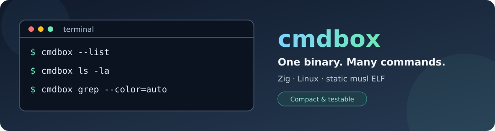

# 🧰 cmdbox — 1つのバイナリに、使い慣れたLinuxコマンドを。

[**English**](README.md) · [**日本語**](README-ja.md)


[](LICENSE)



**cmdboxは、Linux向けのコンパクトなZig製マルチコールコマンド集です。** 普段使う複数のコマンドを1つの実行ファイルにまとめました。GNU coreutils、grep、sed、diffutils、一般的な`sh`の動作を参考にしながら、小さなバイナリと扱いやすい配布形態を目指しています。

> **互換性について：** 現時点ではGNUコマンドやシェルの**完全な置き換えには対応していません**。すべてのコマンド・オプションを実装しているわけではありません。対応範囲と既知の差分は[COMPATIBILITY.md](COMPATIBILITY.md)をご覧ください。

## ✨ cmdboxの特徴

| | 特徴 |
|---|---|
| 📦 **実行ファイルは1つ** | 複数のコマンドを`cmdbox`から呼び出せます。 |
| 🪶 **小さなサイズ** | `ReleaseSmall`、strip、musl静的リンクを活用。 |
| 🔌 **実行時の共有ライブラリ不要** | 単一のLinux ELFとして配布できます。 |
| 🛠️ **クロスターゲットビルド** | Zigでx86、x86-64、ARM Linux向けにビルド可能。 |
| 🎨 **端末に優しい表示** | `ls`・`grep`・`diff`のカラー表示やANSIエスケープに対応。 |
| 🧪 **互換性を検証** | GNUコマンドなどと出力・動作を自動比較。 |
| 📦 **RPMを作成可能** | 通常のLinux環境や専用rootfs向けにパッケージ化。 |

## 🚀 まず使ってみる

Linuxに**Zig 0.16.x**をインストールして実行します。

```sh
# Linuxホスト向け（musl静的リンク構成）
zig build

# 実装済みコマンドの一覧
./zig-out/bin/cmdbox --list

# コマンドを実行
./zig-out/bin/cmdbox ls -la
```

Zigによる通常のビルドでは、別途クロスコンパイラを準備したり外部ソースをダウンロードしたりする必要はありません。生成されるファイルは**`zig-out/bin/cmdbox`**です。

## 🖥️ 使用例

### いつものコマンドをまとめて実行

```sh
cmdbox --list
cmdbox ls -la
cmdbox grep --color=always -n 'pattern' file
cmdbox diff --color=always -u old new
```

これらの例では`cmdbox`が`PATH`に登録されていることを想定しています。ビルド直後の状態では`./zig-out/bin/cmdbox`に読み替えてください。

### 🎨 カラー表示

```sh
cmdbox ls --color=auto
cmdbox grep --color=always -n 'pattern' file
cmdbox diff --color=always -u old new

LS_COLORS='di=01;34:ln=01;36:ex=01;32:*.zig=33' cmdbox ls --color=always
GREP_COLORS='ms=01;31:fn=35:ln=32:se=36' cmdbox grep --color=always -Hn pattern file
```

`ls`・`grep`・`diff`は`--color=auto`、`always`、`never`に対応しています。**初期設定は無色**です。`auto`では標準出力が端末につながっているかを判定するので、パイプやファイルへの出力には色を付けません。`grep`は`TERM=dumb`なども考慮します。設定には`ls`の`LS_COLORS`、`grep`の`GREP_COLORS`、`diff`の`--palette`を使用できます。

### 🌈 ANSIエスケープとシェルのクォート

```sh
cmdbox echo -e '\e[31mRed\e[0m'
cmdbox printf '\033[1;34m%s\033[0m\n' 'Bold blue'
cmdbox printf '%b\n' '\e[38;5;196m256 colors\e[0m'
cmdbox printf '\e[38;2;12;34;56mRGB\e[0m\n'
cmdbox sh -c "echo \$'\e[32mGreen\e[0m'"
```

- **`echo -e`**：`\a`、`\b`、`\e`、`\f`、`\n`、`\r`、`\t`、`\v`、`\\`、8進数・16進数、出力を打ち切る`\c`に対応。`-E`で展開を無効化できます。
- **`printf`**：書式文字列と`%b`のエスケープ展開に対応。`\uHHHH`と`\UHHHHHHHH`も使用できます。
- **`sh`**：ANSI C形式の`$'…'`クォートを扱えます。

ANSI SGRシーケンスで通常色・256色・RGB（True Color）を出力できます。実際の色の表示は端末側の対応に依存します。`printf`からカーソル移動や画面消去のシーケンスも出力できます。

## 🔧 ターゲット別のビルド

| ターゲット | コマンド |
|---|---|
| Linuxホスト向け・musl静的リンク | `zig build` |
| 32bit x86 / i686 | `zig build -Dtarget=x86-linux-musl -Dcpu=pentiumpro` |
| 32bit ARM hard-float / Cortex-A7 | `zig build -Dtarget=arm-linux-musleabihf -Dcpu=cortex_a7` |
| x86-64デバッグ用 | `zig build -Dtarget=x86_64-linux-musl -Doptimize=Debug -Dstrip=false` |

**HTTPS/TLSを含むリリースビルドの実測サイズ**（Zig 0.16.0、`ReleaseSmall`、strip。有効なバージョンや設定によって変動します）：

| ターゲット | バイト数 | 約 |
|---|---:|---:|
| x86_64-linux-musl | 973,256 | 950 KiB |
| x86-linux-musl / i686 | 1,109,276 | 1,083 KiB |
| arm-linux-musleabihf / Cortex-A7 | 1,005,060 | 982 KiB |

生成物は`file zig-out/bin/cmdbox`、`readelf -l zig-out/bin/cmdbox`、`readelf -d zig-out/bin/cmdbox`で確認できます。ELFのビット数、インタープリター、共有ライブラリ依存を調べられます。x86-64 Linuxで32bit x86版を実行するには、カーネルのIA32実行対応が必要です。また、`SystemCallArchitectures=native`を設定したsystemdユニット（udevルールのヘルパーなど）の中では、32bit版は`SIGSYS`で強制終了されます（カーネルログには`fatal signal 31`と記録されます）。ホストと同じアーキテクチャのパッケージを導入してください。ARM版は実機でも動作を確認してください。

## 📦 RPM作成とBusyBoxからの移行

```sh
make rpm                         # 既定はホストと同じアーキテクチャのstatic RPMとSRPM
make rpm RPM_ARCH=i686            # アーキテクチャ指定
make srpm                        # SRPMのみ
make source                      # ソースアーカイブのみ
make rpm RPM_TOPDIR=/absolute/path
```

ソースは`.tar.bz2`、RPMとSRPMのペイロードもbzip2で圧縮します。
生成先は`rpmbuild/SOURCES/`、`rpmbuild/SRPMS/`、`rpmbuild/RPMS/<arch>/`です。
Zig 0.16.x、rpmbuild、Python 3、binutils、bzip2、gzipと比較用GNUコマンドを使用します。
`./package.sh --target x86_64`のようにアーキテクチャを明示しても作成できます。

本体は`/usr/bin/cmdbox`に配置し、`/bin/busybox`からも呼び出せます。
`Provides: busybox`と`Obsoletes: busybox < 2.0`により旧パッケージを置き換えます。
Zig実装のHTTP/HTTPSにより`Provides: wget`も提供します。外部のダウンロードコマンドには依存しません。
HTTPSの検証にはシステムのPEM CA bundleまたは`--ca-certificate`を使用します。
対応済み67コマンドは旧BusyBoxの所有パスに配置し、既存コマンドを置き換えます。
旧BusyBoxに加えてGNU等も同じパスを所有している環境では、RPMのファイル置換指定が必要です。
事前検査は`rpm -Uvh --test --replacefiles rpmbuild/RPMS/x86_64/cmdbox-0.3.0-b3.x86_64.rpm`で行えます。
`make rpm`はパッケージ作成だけを行い、インストールはしません。

| 配置 | リンク先 |
|---|---|
| `/bin/<applet>` | `busybox` |
| `/sbin/<applet>` | `../bin/busybox` |
| `/usr/bin/<applet>`・`/usr/sbin/<applet>` | `../../bin/busybox` |

全アプレットは`/usr/libexec/cmdbox/`からも使えます。
旧BusyBoxが所有していなかったコマンドも、このディレクトリと`cmdbox <command>`で呼び出せます。
`/usr`の統合・分離の両方でリンクを検証し、本体へのsetuidは設定しません。

**旧BusyBoxの完全な置き換えには未到達です。** 旧パッケージの146コマンド中67パスに対応し、
79コマンドが未実装です。BusyBoxの削除後、別パッケージが提供しない未実装コマンドは使えなくなります。
`awk`・`vi`・DHCP・ファイルシステム管理などが残っています。
アップグレード前に[BUSYBOX-MIGRATION.md](BUSYBOX-MIGRATION.md)を確認してください。
同じ一覧をRPMにも同梱します。オプションはBusyBox独自仕様ではなく、GNU・util-linux・procps等を基準にします。

## 🧪 サイズだけでなく、動作も検証

```sh
python3 tests/compat.py zig-out/bin/cmdbox
python3 tests/gnu_compat.py zig-out/bin/cmdbox
python3 tests/fs_compat.py zig-out/bin/cmdbox
python3 tests/color_compat.py zig-out/bin/cmdbox
python3 tests/temp_compat.py zig-out/bin/cmdbox
python3 tests/extended_compat.py zig-out/bin/cmdbox
python3 tests/compression_compat.py zig-out/bin/cmdbox
python3 tests/wget_compat.py zig-out/bin/cmdbox
python3 tests/package_layout.py
```

出力・終了コード、ファイル内容・権限・リンク・属性、ANSIバイト列、PTYを使った自動色判定などを比較します。RPMの`%check`でもx86系では比較テストを実行します。全ターゲットで共有ライブラリ依存を検証しますが、ARM版の実行は別途実機で確認します。`mount`や`reboot`などの**特権操作は比較テストで実行しません**。

最新の対応コマンド、オプション、残る差分については**[COMPATIBILITY.md](COMPATIBILITY.md)**と`cmdbox --list`を参照してください。

## 🤝 開発への参加

互換性の違いや問題の報告を歓迎します。再現に使用した`cmdbox`コマンド、期待したGNUコマンドの動作、実際の出力・終了コード、ターゲットのアーキテクチャ、Zigのバージョンを添えていただけると、修正と検証がしやすくなります。

## 📜 ライセンス

ソースコードは**[Mozilla Public License 2.0（MPL-2.0）](LICENSE)**です。静的リンクするmuslの通知は[`LICENSE.musl`](LICENSE.musl)に含まれています。

---

**cmdbox** — 使い慣れたLinuxコマンドを、コンパクトな静的バイナリで。互換性も実測で確かめる。🧰
