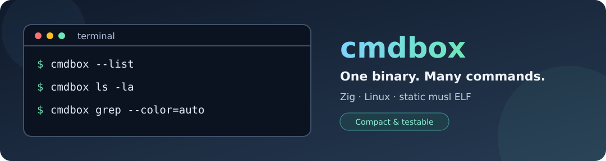

# 🧰 cmdbox — One binary. Many familiar Linux commands.

[**English**](README.md) · [**日本語**](README-ja.md)


[](LICENSE)



**A compact, Zig-powered multicall command suite for Linux.** cmdbox brings everyday command-line tools together in a single executable. It aims for familiar behavior based on GNU coreutils, grep, sed, diffutils, and conventional `sh` implementations—while keeping the binary small and simple to deploy.

> **Compatibility note:** cmdbox is **not yet a complete drop-in replacement** for GNU tools or a full shell. Not every command or option is supported. See [COMPATIBILITY.md](COMPATIBILITY.md) for the current coverage and known differences.

## ✨ Why cmdbox?

| | What you get |
|---|---|
| 📦 **One executable** | Invoke multiple utilities through the same `cmdbox` binary. |
| 🪶 **Small footprint** | Size-focused `ReleaseSmall`, symbol stripping, and static musl linking. |
| 🔌 **No runtime shared libraries** | The release builds produce a standalone Linux ELF executable. |
| 🛠️ **Cross-target builds** | Build for x86, x86-64, and ARM Linux targets with Zig. |
| 🎨 **Terminal-friendly** | Color-aware `ls`, `grep`, and `diff`, plus ANSI escape support. |
| 🧪 **Compatibility-driven** | Automated comparisons against familiar GNU commands and shell behavior. |
| 📦 **RPM packaging** | Package utilities for regular systems or a purpose-built root filesystem. |

## 🚀 Quick start

With **Zig 0.16.x** installed on Linux:

```sh
# Build for the Linux host (static musl configuration)
zig build

# Discover the commands implemented in your build
./zig-out/bin/cmdbox --list

# Run a familiar utility
./zig-out/bin/cmdbox ls -la
```

No separate cross-compiler toolchain or external source download is needed for the direct Zig build. The resulting executable is at **`zig-out/bin/cmdbox`**.

## 🖥️ Try it

### Familiar commands, one entry point

```sh
cmdbox --list
cmdbox ls -la
cmdbox grep --color=always -n 'pattern' file
cmdbox diff --color=always -u old new
```

The examples assume `cmdbox` is on your `PATH`. While working in a fresh checkout, use `./zig-out/bin/cmdbox` instead.

### 🎨 Terminal colors

```sh
cmdbox ls --color=auto
cmdbox grep --color=always -n 'pattern' file
cmdbox diff --color=always -u old new

LS_COLORS='di=01;34:ln=01;36:ex=01;32:*.zig=33' cmdbox ls --color=always
GREP_COLORS='ms=01;31:fn=35:ln=32:se=36' cmdbox grep --color=always -Hn pattern file
```

For `ls`, `grep`, and `diff`, `--color=auto`, `always`, and `never` are available. The default is **no color**. `auto` checks whether standard output is connected to a terminal, so redirected output and pipelines remain uncolored. `grep` also considers settings such as `TERM=dumb`. `ls` uses `LS_COLORS`, `grep` uses `GREP_COLORS`, and `diff` offers `--palette`.

### 🌈 ANSI escapes and shell quoting

```sh
cmdbox echo -e '\e[31mRed\e[0m'
cmdbox printf '\033[1;34m%s\033[0m\n' 'Bold blue'
cmdbox printf '%b\n' '\e[38;5;196m256 colors\e[0m'
cmdbox printf '\e[38;2;12;34;56mRGB\e[0m\n'
cmdbox sh -c "echo \$'\e[32mGreen\e[0m'"
```

- **`echo -e`**: common control escapes (`\a`, `\b`, `\e`, `\f`, `\n`, `\r`, `\t`, `\v`, `\\`), octal/hex values, and `\c` to stop output; `-E` disables expansion.
- **`printf`**: escape expansion in the format string and `%b`, including `\uHHHH` and `\UHHHHHHHH`.
- **`sh`**: ANSI-C-style `$'…'` quoting.

ANSI SGR sequences can express standard, 256-color, and true-color (RGB) text. How they appear depends on your terminal; `printf` can also output cursor movement and screen-clearing sequences.

## 🔧 Build for your target

| Target | Command |
|---|---|
| Linux host, static musl | `zig build` |
| 32-bit x86 / i686 | `zig build -Dtarget=x86-linux-musl -Dcpu=pentiumpro` |
| 32-bit ARM hard-float / Cortex-A7 | `zig build -Dtarget=arm-linux-musleabihf -Dcpu=cortex_a7` |
| x86-64 debug | `zig build -Dtarget=x86_64-linux-musl -Doptimize=Debug -Dstrip=false` |

**Measured release-build sizes including HTTPS/TLS** (Zig 0.16.0, `ReleaseSmall`, stripped; snapshots, not guaranteed sizes):

| Target | Bytes | Approximate size |
|---|---:|---:|
| x86_64-linux-musl | 973,256 | 950 KiB |
| x86-linux-musl / i686 | 1,109,276 | 1,083 KiB |
| arm-linux-musleabihf / Cortex-A7 | 1,005,060 | 982 KiB |

Inspect the generated executable with `file zig-out/bin/cmdbox`, `readelf -l zig-out/bin/cmdbox`, and `readelf -d zig-out/bin/cmdbox` to check ELF class, interpreter, and dynamic dependencies. Running a 32-bit x86 binary on an x86-64 Linux machine requires the kernel to support IA32 execution, and such a binary is killed with `SIGSYS` (logged as `fatal signal 31`) inside systemd units that set `SystemCallArchitectures=native`, such as udev rule helpers. Install the package that matches the host architecture. ARM runtime behavior should be checked on the target device.

## 📦 RPM packages and BusyBox migration

```sh
make rpm                         # host-architecture static RPM and SRPM (default)
make rpm RPM_ARCH=i686            # choose another RPM architecture
make srpm                        # source RPM only
make source                      # source archive only
make rpm RPM_TOPDIR=/absolute/path
```

`make rpm` uses `cmdbox.spec`. Source archives are **`.tar.bz2`**, and both the binary RPM
and SRPM use **bzip2 payload compression**. Artifacts are in `rpmbuild/SOURCES/`,
`rpmbuild/SRPMS/`, and `rpmbuild/RPMS/<arch>/`.
Zig 0.16.x, rpmbuild, Python 3, binutils, bzip2, gzip and the GNU comparison tools are required.
The direct helper `./package.sh --target x86_64` builds the same package for an explicit architecture.

The package declares `Provides: busybox` and `Obsoletes: busybox < 2.0`.
Its single executable is `/usr/bin/cmdbox`, with `/bin/busybox` as a compatible dispatch entry point.
HTTP/HTTPS downloads are implemented in Zig and advertised through `Provides: wget`.
HTTPS uses the system PEM CA bundle or `--ca-certificate`, without an external download command.

All 68 implemented legacy command paths replace the existing commands.
If GNU or other packages also own these paths, RPM requires explicit file replacement.
Check the transaction with `rpm -Uvh --test --replacefiles rpmbuild/RPMS/x86_64/cmdbox-0.3.0-b3.x86_64.rpm`.
`make rpm` builds packages without installing them.

Legacy command paths follow the reference package `busybox-1.22.1-b2.i686`:

| Directory | Link target |
|---|---|
| `/bin/<applet>` | `busybox` |
| `/sbin/<applet>` | `../bin/busybox` |
| `/usr/bin/<applet>`, `/usr/sbin/<applet>` | `../../bin/busybox` |

Only implemented commands are linked. All applets are also accessible under
`/usr/libexec/cmdbox/`, including commands that the reference BusyBox package did not own.
The layout is checked with both separate and merged `/usr` directories. The executable is not setuid.

**This is not yet a complete BusyBox replacement:** 68 of the reference package's 146 command
paths are currently implemented; 78 are missing. Removing BusyBox removes those commands unless
another package provides them. Review [BUSYBOX-MIGRATION.md](BUSYBOX-MIGRATION.md) before upgrading;
the same generated report is included in the RPM. among the gaps (`vi` is now available as a minimal visual editor; see [COMPATIBILITY.md](COMPATIBILITY.md)). Options are based on standard GNU/util-linux/procps tools, not BusyBox-specific syntax.

## 🧪 Test behavior—not just size

cmdbox compares supported behavior with standard utilities across output, exit status, filesystem semantics, and terminal handling:

```sh
python3 tests/compat.py zig-out/bin/cmdbox
python3 tests/gnu_compat.py zig-out/bin/cmdbox
python3 tests/fs_compat.py zig-out/bin/cmdbox
python3 tests/color_compat.py zig-out/bin/cmdbox
python3 tests/temp_compat.py zig-out/bin/cmdbox
python3 tests/extended_compat.py zig-out/bin/cmdbox
python3 tests/compression_compat.py zig-out/bin/cmdbox
python3 tests/wget_compat.py zig-out/bin/cmdbox
python3 tests/package_layout.py
```

Tests cover output and exit codes; file contents, permissions, links, and attributes; ANSI byte sequences; and automatic color detection via a pseudo-terminal (PTY). RPM `%check` also runs comparison tests on x86. Shared-library dependency checks are performed for all build targets; ARM execution needs separate device validation. Privileged operations such as `mount` and `reboot` are **not** executed by the comparison tests.

For the actual supported commands, option coverage, and differences, consult **[COMPATIBILITY.md](COMPATIBILITY.md)** and run `cmdbox --list`.

## 🤝 Contributing

Reports of compatibility differences are especially helpful. When reporting a problem, please include the `cmdbox` command, the GNU/reference behavior you expected, the actual output and exit status, the target architecture, and your Zig version. Reproducible test cases make fixes easier to verify.

## 📜 License

Source code: **[Mozilla Public License 2.0 (MPL-2.0)](LICENSE)**. The notification for statically linked musl is included in [`LICENSE.musl`](LICENSE.musl).

---

**cmdbox** — familiar Linux commands, a compact static binary, and compatibility you can test. 🧰
